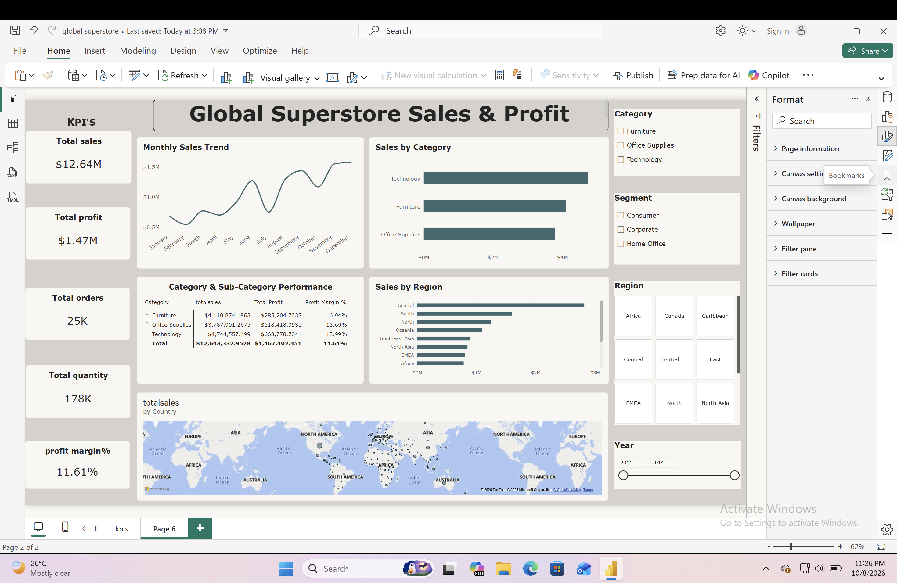

# 📊 Global Superstore Sales & Profit Performance Analytics

## 📌 Project Overview
An interactive Power BI dashboard analyzing 51,000+ transactional records (2011–2014) for a global retail business. The objective is to evaluate sales drivers, regional profit trends, and product category margins to support executive decision-making.

---

## 📸 Dashboard Preview


---

## 🎯 Key Metrics (KPIs)
* **Total Sales:** $12.64M
* **Total Profit:** $1.47M
* **Total Orders:** 25,035
* **Total Quantity Sold:** 178K
* **Overall Profit Margin %:** 11.61%

---

## 💡 Key Business Insights
1. **Highest Profitability Driver:** **Technology** led across categories with **$4.74M** in total sales and **$663.8K** in total profit (**13.99%** margin).
2. **Low-Margin Performance:** **Furniture** generated **$4.11M** in sales but had a lower profit margin of **6.94%** due to higher shipping costs and discounting.
3. **Steady Volume:** **Office Supplies** maintained a healthy profit margin of **13.69%** across high-volume orders.

---

## 🛠️ Tools & Data Pipeline
* **Data Source:** Global Superstore Transactional Dataset (Excel/CSV)
* **Data Transformation:** Power Query (type validation, duplicate removal, column trimming)
* **Data Modeling:** Custom DAX measures (`SUM`, `DISTINCTCOUNT`, `DIVIDE`)
* **Visualization:** Power BI Desktop (Interactive slicers, Line charts, Maps, Matrix views)

---

## 📐 DAX Formulas Used
```dax
Total Sales = SUM(Orders[Sales])
Total Profit = SUM(Orders[Profit])
Total Orders = DISTINCTCOUNT(Orders[Order ID])
Average Order Value = DIVIDE([Total Sales], [Total Orders], 0)
Profit Margin % = DIVIDE([Total Profit], [Total Sales], 0)
Total Quantity=sum(orders[Quantity])
```

